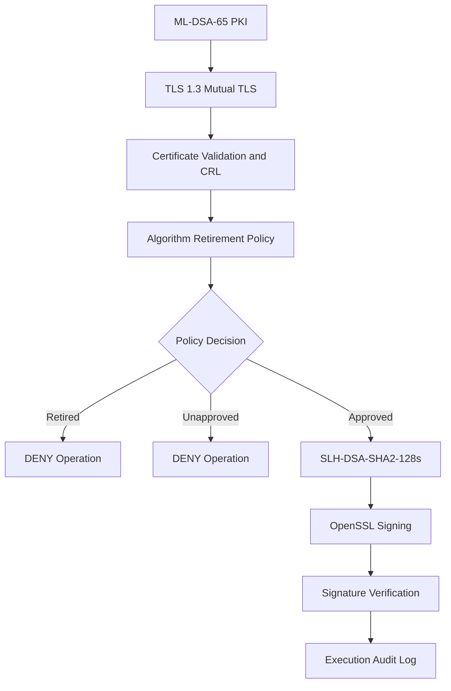

# PQC PKI Migration Lab

**A Practical Proof of Concept for Post-Quantum PKI Migration and Cryptographic Algorithm Retirement**

This laboratory project explores how an organization can prepare for cryptographic algorithm retirement and transition to an approved replacement without treating algorithm migration as a simple configuration change.

The central design principle is:

**Design the algorithm exit path before deploying the algorithm.**

## Architecture Overview



## Implemented Capabilities

### 1. Post-Quantum PKI
- ML-DSA-65 Root and Intermediate CA.
- Client and server certificate issuance.
- Certificate-chain validation.
- SLH-DSA-SHA2-128s replacement trust chain.

### 2. TLS 1.3 Mutual Authentication
- TLS 1.3 handshake.
- X25519MLKEM768 key exchange group.
- ML-DSA-based client and server authentication.
- Missing and untrusted client certificate rejection.
- SLH-DSA-based mTLS laboratory test.

### 3. Certificate Revocation
- OpenSSL CA database.
- Certificate revocation.
- CRL generation and signature verification.
- Offline CRL-based revocation enforcement.

### 4. Algorithm Retirement Engine
- JSON-based cryptographic algorithm policy.
- Default-deny policy evaluation.
- Automated policy test runner.
- Policy-controlled OpenSSL execution wrapper.
- JSONL execution audit trail.

## Demonstrated Test Results

| Test | Result |
|---|---|
| ML-DSA-65 PKI validation | PASS |
| TLS 1.3 with X25519MLKEM768 | PASS |
| mTLS client authentication | PASS |
| Missing/untrusted client rejection | PASS |
| CRL revocation enforcement | PASS |
| SLH-DSA replacement trust chain | PASS |
| SLH-DSA mTLS | PASS |
| Retired ML-DSA-65 blocked | PASS |
| Approved SLH-DSA signing | PASS |
| SLH-DSA signature verification | PASS |
| Tampered message rejection | PASS |
| Automated policy tests | 3/3 PASS |

## Algorithm Retirement Demonstration

| Algorithm | Policy Decision | Behaviour |
|---|---|---|
| ML-DSA-65 | DENY | Signing operation blocked |
| ML-DSA-44 | DENY | Unapproved algorithm blocked |
| SLH-DSA-SHA2-128s | ALLOW | Signing and verification successful |

## Project Structure

```text
PQC-PKI-Migration-Lab/
├── algorithm-retirement/
│   ├── policies/
│   ├── results/
│   ├── keys/
│   ├── policy_engine.py
│   ├── guarded_sign.py
│   ├── run_tests.py
│   └── git_audit.py
├── classical-pki/
├── clients/
├── docs/
│   ├── algorithm-retirement-lab-report.md
│   └── PROJECT-CHECKLIST.md
├── pqc-pki/
├── results/
│   └── mtls-pqc-test-report.md
├── tests/
├── .gitignore
└── README.md
```

## Run the Policy Tests

```powershell
python algorithm-retirement\run_tests.py
```

## Run Guarded Signing

Approved replacement:

```powershell
python algorithm-retirement\guarded_sign.py SLH-DSA-SHA2-128s
```

Retired algorithm:

```powershell
python algorithm-retirement\guarded_sign.py ML-DSA-65
```

## Security and Scope

This project is a laboratory proof of concept, not a production enterprise migration platform.

The execution guard controls only operations routed through the Python wrapper. It does not globally disable algorithms in OpenSSL or other applications.

The project does not yet demonstrate enterprise-wide asset discovery, production HSM/KMS integration, multi-vendor interoperability, or automated migration across external services.

Private keys and sensitive local test material are intentionally excluded from the public repository.

## Future Engineering Work

- Enterprise cryptographic asset inventory.
- Algorithm dependency mapping.
- Distributed cryptographic policy enforcement.
- Automated certificate and key lifecycle migration.
- HSM and cloud KMS integration.
- Migration rollback and trust-continuity testing.
- Multi-vendor interoperability testing.

## Conclusion

This project demonstrates a practical laboratory approach to post-quantum PKI migration and algorithm retirement.

It explores how retired cryptographic algorithms can be blocked through an application-level policy gate while an approved replacement performs real cryptographic signing and verification.

**The objective is not simply to replace an algorithm. It is to engineer a controlled, auditable and testable algorithm exit path.**
