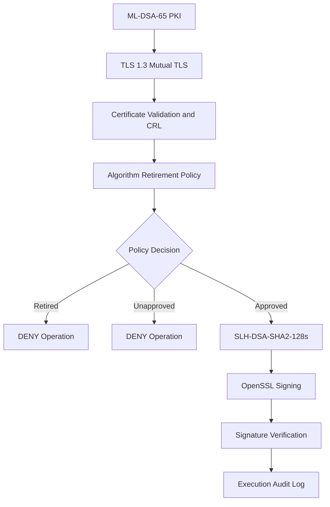

# PQC PKI Migration Lab

**A Practical Proof of Concept for Post-Quantum PKI Migration and Cryptographic Algorithm Retirement**

This laboratory project explores how an organization can prepare for cryptographic algorithm retirement and transition to an approved replacement without treating algorithm migration as a simple configuration change.

The central design principle is:

**Design the algorithm exit path before deploying the algorithm.**

## Architecture Overview



## Implemented Capabilities

### 1. Post-Quantum PKI (local lab)
- ML-DSA-65 Root and Intermediate CA.
- Client and server certificate issuance.
- Certificate-chain validation.
- SLH-DSA-SHA2-128s replacement trust chain.

### 2. TLS 1.3 Mutual Authentication (local lab)
- TLS 1.3 handshake.
- X25519MLKEM768 key exchange group.
- ML-DSA-based client and server authentication.
- Missing and untrusted client certificate rejection.
- SLH-DSA-based mTLS laboratory test.

### 3. Certificate Revocation (local lab)
- OpenSSL CA database.
- Certificate revocation.
- CRL generation and signature verification.
- Offline CRL-based revocation enforcement.

### 4. Algorithm Retirement Engine (public repository)
- JSON-based cryptographic algorithm policy.
- Default-deny policy evaluation.
- Automated policy test runner.
- Policy-controlled OpenSSL execution wrapper.
- JSONL execution audit trail.

## Demonstrated Test Results

### Publicly reproducible: retirement policy tests

The policy engine, policy JSON, test runner, and recorded JSON report are included in this repository. Re-run the tests with the command below.

| Test | Expected decision | Recorded result |
|---|---|---|
| Retired ML-DSA-65 | DENY | PASS |
| Approved SLH-DSA-SHA2-128s | ALLOW | PASS |
| Unapproved ML-DSA-44 | DENY | PASS |
| **Overall** | | **3/3 PASS** |

The committed JSON report is a recorded run; running the test command generates a fresh report.

### Lab-reported: local evidence

The following results are documented from local laboratory runs. The public repository contains reports, not the complete PKI lab files, certificates, or keys needed to reproduce these runs from a clean clone.

| Local lab test | Reported result |
|---|---|
| ML-DSA-65 PKI and certificate-chain validation | PASS |
| TLS 1.3 with X25519MLKEM768 | PASS |
| mTLS client authentication; missing/untrusted client rejection | PASS |
| CRL generation and offline revocation enforcement | PASS |
| SLH-DSA replacement trust chain and mTLS | PASS |
| SLH-DSA signing, verification, and tampered-message rejection | PASS |

See [the mTLS lab report](results/mtls-pqc-test-report.md) and [the detailed lab report](docs/algorithm-retirement-lab-report.md). These are recorded local-lab results, not clean-clone reproducibility claims.

## Algorithm Retirement Demonstration

| Algorithm | Policy Decision | Behaviour |
|---|---|---|
| ML-DSA-65 | DENY | Signing operation blocked by policy |
| ML-DSA-44 | DENY | Unapproved algorithm blocked |
| SLH-DSA-SHA2-128s | ALLOW | Approved by policy; local signing test reported separately |

## Public Repository Structure

Only paths present in the public GitHub repository are shown below.

```text
PQC-PKI-Migration-Lab/
├── algorithm-retirement/
│   ├── policies/
│   │   └── algorithm-policy.json
│   ├── results/
│   │   ├── retirement-policy-test-report.json
│   │   └── execution-audit.jsonl
│   ├── git_audit.py
│   ├── guarded_sign.py
│   ├── policy_engine.py
│   └── run_tests.py
├── docs/
│   ├── algorithm-retirement-lab-report.md
│   └── PROJECT-CHECKLIST.md
├── results/
│   └── mtls-pqc-test-report.md
├── .gitignore
└── README.md
```

**Local lab only — not published:** `classical-pki/`, `pqc-pki/`, `clients/`, `tests/`, and local `algorithm-retirement/keys/` and generated signing inputs/outputs. These paths are not part of the public repository tree.

## Run the Public Policy Tests

Requires Python 3.

```powershell
python algorithm-retirement\run_tests.py
```

This runs the three policy-decision tests and writes a fresh report to `algorithm-retirement/results/retirement-policy-test-report.json`.

## Run Guarded Signing

**Prerequisites:** Requires local OpenSSL and local keys under `algorithm-retirement/keys/` (keys are not published). The local sample message at `algorithm-retirement/results/sample-message.txt` is also required. Install OpenSSL and ensure it is on PATH, or set `OPENSSL_BIN` to its executable.

Approved replacement:

```powershell
python algorithm-retirement\guarded_sign.py SLH-DSA-SHA2-128s
```

Retired algorithm (blocked by policy before OpenSSL signing):

```powershell
python algorithm-retirement\guarded_sign.py ML-DSA-65
```

## Security and Scope

This project is a laboratory proof of concept, not a production enterprise migration platform.

**PKI/mTLS PASS rows refer to local lab runs; this public repo ships the retirement policy engine and recorded policy-test output.**

The execution guard controls only operations routed through the Python wrapper. It does not globally disable algorithms in OpenSSL or other applications.

The project does not yet demonstrate enterprise-wide asset discovery, production HSM/KMS integration, multi-vendor interoperability, or automated migration across external services.

Private keys and sensitive local test material are intentionally excluded from the public repository. Before pushing changes, run the read-only security preflight:

```powershell
python algorithm-retirement\git_audit.py
```

Review any findings before publishing. This preflight is not a complete secret scanner and does not replace manual review.

## Future Engineering Work

- Enterprise cryptographic asset inventory.
- Algorithm dependency mapping.
- Distributed cryptographic policy enforcement.
- Automated certificate and key lifecycle migration.
- HSM and cloud KMS integration.
- Migration rollback and trust-continuity testing.
- Multi-vendor interoperability testing.

## Conclusion

This project demonstrates a practical laboratory approach to post-quantum PKI migration and algorithm retirement.

It explores how retired cryptographic algorithms can be blocked through an application-level policy gate while an approved replacement performs real cryptographic signing and verification in the local lab.

**The objective is not simply to replace an algorithm. It is to engineer a controlled, auditable and testable algorithm exit path.**
